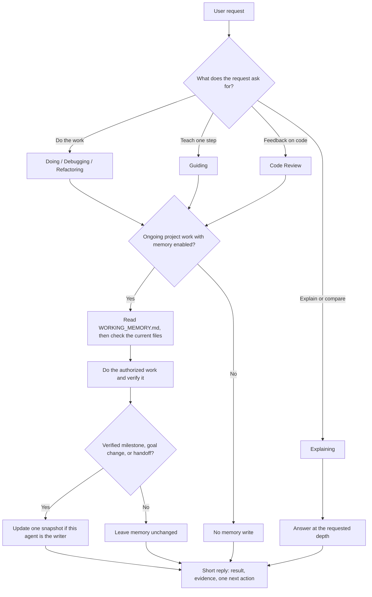
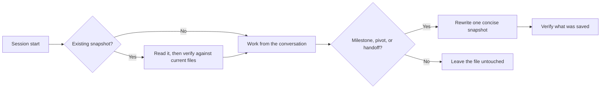
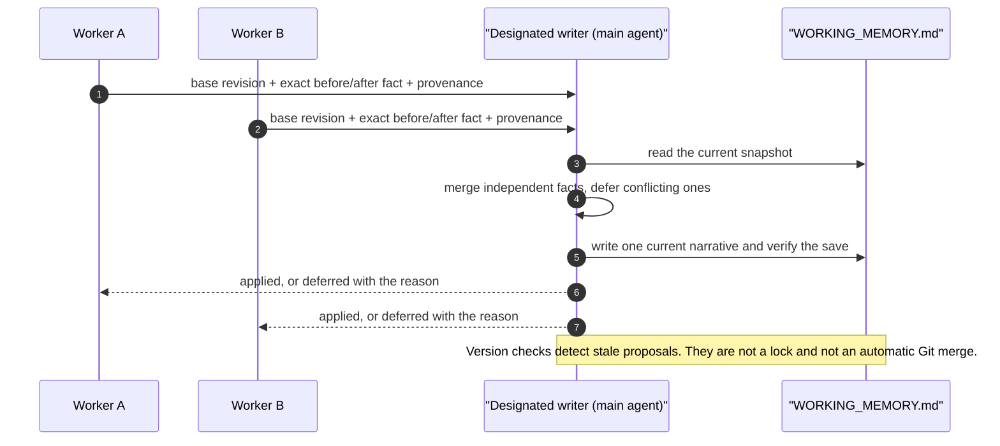
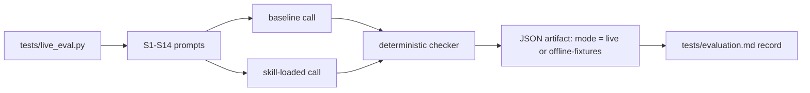

# ADHD Coding Skill

[](https://github.com/ramazanemin/adhd-coding-skill/actions/workflows/validate.yml)
[](LICENSE)

**Clearer coding conversations. One useful next step when you need guidance. Completed work when you ask for it.**

An instruction-only [Agent Skill](https://learn.chatgpt.com/docs/build-skills) for ADHD-friendly coding collaboration. It keeps explanations manageable, helps you recover the current task after a break, and stops every new idea from becoming extra work. You can use these preferences whether or not you have ADHD: they are adjustable communication defaults, not assumptions about you.

No dependencies, no background service, no vector database. The shipped artifact is one Markdown file plus optional host metadata.

---

## Contents

- [Why this exists](#why-this-exists)
- [The six modes](#the-six-modes)
- [How it works](#how-it-works)
- [Quick start](#quick-start)
- [Persistent working memory](#persistent-working-memory)
- [Parallel work: propose, merge, commit](#parallel-work-propose-merge-commit)
- [Worked examples](#worked-examples)
- [Acceptance scenarios](#acceptance-scenarios)
- [Repository layout](#repository-layout)
- [Development](#development)
- [Design limits](#design-limits)
- [FAQ](#faq)
- [License](#license)

## Why this exists

Long coding answers are hard to act on when working memory is already loaded. The usual failure modes are predictable:

| Failure mode | What this skill does instead |
| --- | --- |
| A ten-step roadmap when you asked where to start | Gives one concrete action with a visible finish line, then waits |
| A "where were we?" answer invented from nothing | States what is verifiably known, says what is not, and offers one way to recover |
| Asking permission you already granted | Keeps working until the requested result is verified or a real blocker appears |
| A new side idea silently expanding the task | Acknowledges and parks it, then continues the current goal |
| Hiding a failing test behind a short summary | Reports the failure and the exact blocker, however terse the request was |
| Short answers enforced even when you asked for depth | Answers at the depth you asked for, including full examples |

## The six modes

The mode comes from the request itself, never from an intake questionnaire.

| Mode | Use when | What you get |
| --- | --- | --- |
| **Doing** | "Fix it", "implement it", "test it" | The authorized work performed and verified, with a short result |
| **Guiding** | "Teach me", "where do I start?" | One action step with a completion condition, then a pause |
| **Explaining** | "Explain", "compare", "why?" | A direct answer at the requested depth, in one response |
| **Debugging** | "This fails", "find the bug" | Reproduction, smallest failing case, minimal fix, verification |
| **Refactoring** | "Clean this up, keep behavior" | Small behavior-preserving changes, verified one at a time |
| **Code Review** | "Review this", "what should I fix first?" | Blockers first, then suggestions, with file/line references |

Say "stop using this style" or "give me the full plan" at any time; the skill follows the newer instruction immediately.

## How it works



Three rules hold across every mode:

1. **Evidence over confidence.** A claim about a fix, test, or file must come from something that actually ran.
2. **One snapshot, not a transcript.** Project state lives in a single prose file, kept current instead of appended forever.
3. **Your scope stays yours.** Required checks from the user, the project, or other skills are preserved; the skill adds no approval gates and grants no extra authority.

## Quick start

### Codex (project level)

1. Clone or download this repository.
2. In the project where you want the skill, create `.agents/skills` if needed.
3. Copy `skills/adhd-coding` into it, so you end up with `.agents/skills/adhd-coding/SKILL.md`.
   If that folder already exists, compare versions and preserve your edits before replacing anything.
4. Invoke it in a conversation:

```text
$adhd-coding Help me finish the login form. Keep updates short and do the implementation and tests.
```

### Codex (all projects)

Copy the same folder to the user-level location instead:

```text
~/.agents/skills/adhd-coding/SKILL.md
```

Windows equivalent: `C:\Users\<you>\.agents\skills\adhd-coding\SKILL.md`. Restart Codex if the skill does not appear.

### Other Agent Skills-compatible hosts

Install the same `skills/adhd-coding` folder using that host's instructions. `agents/openai.yaml` is optional Codex metadata; hosts that do not read it can ignore it. This repository does not claim that every host has been tested.

### Sanity check

```text
$adhd-coding I lost the thread. Summarize the last verified state and resume the current task.
```

A healthy response states what is verified, what is unknown, and one next action, in roughly 80 words or fewer.


## Persistent working memory

A distracted session usually dies at the handoff: the context lives in a chat that is gone tomorrow. The skill keeps one concise prose snapshot in the target project's `WORKING_MEMORY.md`, or in the equivalent handoff file that the project instructions already designate.

### What gets recorded

- The active goal and the last **verified** state
- Decisions with their reasons
- Changed file paths
- Test commands with outcomes and the date they were observed
- Blockers, deferred ideas, and the agreed next action (or an explicit "none assigned")
- Unknowns, clearly marked as unknown

It distinguishes *user-reported* results from *observed* results, omits secrets and personal health information, and keeps one current narrative instead of a growing transcript. It references other skills' plans and reports by path rather than copying them.

### When it writes, and when it stays quiet

| Situation | Behavior |
| --- | --- |
| Verified milestone, explicit goal change, session handoff | Update the snapshot within existing write permissions |
| Standalone question, read-only review, "don't update memory" | No memory write at all |
| No file tools or no write permission | Say plainly that the checkpoint cannot be saved; invent nothing |
| Memory exists but the code moved on | Read memory, then check the current files; old test results are history, not proof |



Saving the file does not guarantee that a future session loads the skill, or that the host even reads that path. Memory is a durable note for the next agent, not a platform feature.


## Parallel work: propose, merge, commit

When several agents touch one project, memory is the shared file that races are made of. Measured on this repo: ten two-writer rounds without coordination lost a decision in **10 of 10** runs, while a single-writer protocol preserved both decisions in **10 of 10**. Naive "re-read before writing" is not enough, so the skill uses a Git-like protocol instead.



The rules, in full:

1. **One writer per project.** Follow the project's existing coordinator; in a coordinated agent team this is normally the main agent. A lone agent writes its own checkpoint.
2. **Workers propose, they do not edit.** The handoff carries the base revision (hash or version), the exact before/after facts, and the source and date of any verification. Proposals stay in the handoff channel, not in per-agent memory files.
3. **Independent changes merge.** The writer preserves unrelated current information instead of overwriting it.
4. **Competing facts are not guessed.** Use the latest explicit user instruction or verified evidence; if neither resolves it, keep the current fact, defer that change, and report what is needed. Never silently prefer the newest proposal.
5. **No writer, no write.** If ownership is unknown, return the proposal and defer the checkpoint while continuing other authorized work. Do not elect rival writers in separate chats.

| This gives you | This does **not** give you |
| --- | --- |
| A merge contract every agent can follow without extra tooling | A filesystem or database lock |
| Stale-proposal detection through revision checks | Atomic compare-and-swap |
| Explicit conflict handling with a human-readable reason | Automatic Git merging or branching |
| One canonical file per project | Crash recovery, cross-machine coordination, or protection from non-participants |

Safety depends on all participants honoring the same writer. That is a documented limitation, not a hidden one.

## Worked examples

**Guiding, with an unknown prerequisite**

> User: "I can't get started on projects because of my ADHD. I want to learn to build a React to-do app. Where should I start?"
>
> Assistant: "Let's pick the first step from your current setup: do you have a React project you can open and run on your computer?"

**Resuming and parking a side idea**

> User: "I lost the thread, where were we? We could also change the app's color."
>
> Assistant: "Form validation is complete; we are on the step of connecting submit to the API (I noted the color change for after this step). First action: open the `handleSubmit` function; we'll add the request call there."

**Debugging**

> User: "`POST /login` returns 401 instead of 200. Fix it."
>
> Assistant: "I'll reproduce it first. What's the exact request body and headers you're sending, and does the endpoint expect a specific auth header? Once I can reproduce the 401, I'll isolate the payload, the credentials, or the route handler, then apply a minimal fix."

**Refactoring**

> User: "Clean up this function so it's easier to read, but don't change what it does."
>
> Assistant: "I'll extract the validation block into its own function first, then verify the tests still pass before making the next change. Which file and function should I start with?"

**Code review**

> User: "Review this pull request. What should I fix first?"
>
> Assistant: "Blockers first: `src/auth.js:42` compares passwords with `==` instead of a constant-time check, and `src/routes.js:15` doesn't validate the `userId` parameter. Suggestion: extract the repeated fetch logic into a helper. Do you want me to draft the fixes?"


## Acceptance scenarios

Fourteen automated text scenarios (S1–S14) and twelve tool-aware memory scenarios (M1–M12) define what "working" means. The pass criteria are written down, not implied: see [tests/scenarios.md](tests/scenarios.md).

| IDs | Theme | Example check |
| --- | --- | --- |
| S1–S4 | Getting started, resuming, protecting scope, progress updates | One action or one question instead of a roadmap; no fake completion |
| S5–S6 | Honoring a depth request, following an explicit pivot | Full explanation on demand; immediate switch of goal |
| S7–S8 | Honesty about missing history, failure reporting | "No record of that session" plus one recovery step; 401-vs-200 stated plainly |
| S9–S10 | Turning the style off, ordinary technical questions | Constraint dropped on request; no ADHD inference |
| S11–S14 | Working memory: snapshot, disabled memory, stale proposal, no write access | Facts only, no transcript or secrets, conflicts deferred |
| M1–M12 | Real-file memory and parallel-write behavior | Correct file contents and provenance, one writer, no invented persistence |



The offline mode feeds fixed fixtures through the same checkers. It is a self-check of the test harness, never evidence about a model.

## Repository layout

```text
skills/adhd-coding/SKILL.md              Portable skill instructions (the actual product)
skills/adhd-coding/agents/openai.yaml    Optional Codex interface metadata
tests/scenarios.md                       Acceptance scenarios S1-S14 and M1-M12
tests/evaluation.md                      Dated results, method, and limits
tests/validate_package.py                Package, docs, coverage, CI, and whitespace checks
tests/live_eval.py                       Baseline-vs-skill runner with offline fixtures
tests/test_live_eval.py                  Unit tests for the runner (no network)
.github/workflows/validate.yml           CI: unit tests, package checks, offline fixtures
CHANGELOG.md                             Changes by date
LICENSE                                  MIT
```

## Development

### Requirements

- Python 3.8 or newer (standard library only; no `pip install` needed)
- Git, for the whitespace check and the normal contribution flow

### Commands

```bash
# Package, documentation, coverage, CI and whitespace checks
python3 tests/validate_package.py

# Runner unit tests (no network access)
python3 -m unittest discover -s tests -p "test_*.py" -v

# Offline fixture evaluation: checks the checkers, not a model
python3 tests/live_eval.py --offline

# Live baseline-vs-skill comparison (needs an OpenAI-compatible endpoint)
python3 tests/live_eval.py --api-url https://your-endpoint/v1/chat/completions \
  --api-key "$AI_API_KEY" --model your-model
```

Useful flags: `--scenarios S1,S11` runs a subset, `--concurrency N` parallelizes (default 1), `--output path.json` chooses the artifact path. The resolved provider is printed before any request, and an unconfigured run warns instead of silently using the shared anonymous endpoint.

### Continuous integration

[`.github/workflows/validate.yml`](.github/workflows/validate.yml) runs on every push and pull request: unit tests, package validation, and the offline fixture evaluation, with the JSON artifact uploaded. Live model calls are deliberately excluded, because free API tiers rate-limit and cannot give reproducible results.

## Design limits

- **Instruction-only.** The host supplies file tools and enforces permissions; the skill cannot grant itself access.
- **Communication, not treatment.** No clinical claim, no diagnosis, no medical advice. The preferences are defaults you can override.
- **Checkers are heuristics.** Keyword and length checks can produce both false passes and false failures on paraphrased answers; a failing scenario is a prompt to read the response.
- **Memory is a coordination rule, not infrastructure.** No lock, no merge automation, no service, no RAG.
- **Recorded results are historical.** The live evaluation in [tests/evaluation.md](tests/evaluation.md) was captured on 2026-10-14 and has not been rerun; one baseline verdict in it is explicitly marked unverified.
- **Not everything is tested.** Installation into a live host, automatic trigger selection, and cross-model reliability remain manual checks.

## FAQ

**Do I need ADHD to use this?**
No. The skill treats these as adjustable communication preferences. It never infers ADHD from typos, terse messages, or ordinary programming questions.

**Does it slow down real work?**
No. "Doing" mode keeps working until the request is verified. The short updates describe the report, not a limit on the work.

**Will it overwrite my project instructions?**
No. Higher-priority project rules and other skills' required checks are preserved. The skill adds no approval gates.

**Is there a service or an API key?**
No. The skill is Markdown. Only the optional live evaluation runner talks to an API, and only when you run it.

**Can I turn the memory off?**
Yes: say "don't update memory". It also writes nothing for standalone questions and read-only tasks.

**Why a single file instead of a vector database?**
Project state is small, changes often, and should stay reviewable in a diff. Retrieval infrastructure adds failure modes without solving the actual problem, which is knowing what was verified.

## Contributing

1. Read [tests/scenarios.md](tests/scenarios.md) and the limits in [tests/evaluation.md](tests/evaluation.md).
2. Change one behavior at a time, in `SKILL.md` or in the harness.
3. Run the offline commands above; all must pass.
4. Describe the observable behavior you changed and the scenario IDs you exercised. Record any limits you did not test.

## License

[MIT](LICENSE)
